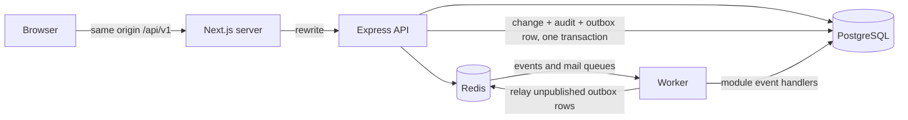

# Phoenix Platform architecture

This document explains how phase 1 (the foundation) is built, the decisions behind it, and how to extend it. The README covers installing and running.

## 1. Summary

Phoenix Educational Institute runs several companies (Pi Vector, SatnPaper, Excel and more). They sell to families and students (test prep, admissions) and to coaching institutes and mentors (ERP and test software). The platform gives all of them one place for leads, bookings, admissions, payments and onboarding, while each company, branch and team sees only its own work.

Phase 1 builds what every later feature depends on:

| Area | What's there |
| --- | --- |
| Organisation | A tree of any depth (group → company → region → branch → team). Unit types are configuration, with typed profiles (GSTIN, PAN, address, brand colour). |
| Access | Permission strings grouped by module, built-in and custom roles, roles assigned at any unit and inherited by everything below, own-records-only scope, and checks that stop people giving away permissions they don't hold. |
| Settings | Typed settings defined by modules, set at allowed levels and inherited down the tree. |
| Identity | Email and password sign-in, invitations, password reset, two-step verification (authenticator app and recovery codes), a policy to require it, and device sessions. |
| Audit and events | An audit entry for every change, written in the same transaction, and domain events delivered through a transactional outbox and a background worker. |
| Extensibility | A module registry: modules add permissions, role grants, settings, unit types, event handlers and routes without changing the core. |
| Web app | Strict TypeScript. Sign-in pages, a home page, and settings for organisation, people, roles, general settings, the audit log and the user's own account. |

## 2. Stack and why

Kept deliberately small: one database, one cache and queue, one API, one web app.

- **PostgreSQL 16** stores everything. Materialised paths make "this unit and everything under it" a single indexed prefix match; JSONB holds per-type profiles; text arrays hold permissions and recovery-code hashes.
- **Redis 7** holds the session and access caches, rate-limit counters, TOTP replay guards and the BullMQ queues.
- **Express 5 (JavaScript, ES modules)** for the API, with **zod** for every input and **knex** for SQL. Express 5 forwards errors from async handlers, so routes have no try/catch boilerplate.
- **BullMQ** runs background jobs (domain events, email) in a separate worker process.
- **Next.js 16 with React 19 and strict TypeScript** for the web app, with **TanStack Query** for server state. The browser only talks to its own origin; Next.js forwards `/api/v1/*` to the API, which keeps the session cookie simple (HttpOnly, SameSite=Lax, no CORS).

## 3. Repository layout

```
apps/api/src
  app.js                    Express app: security headers, request context, CSRF rule, session, module routes
  server.js, worker.js      HTTP server; background worker (outbox relay, event handlers, email)
  registry.js               builds the module registry from modules/index.js
  config/env.js             validated configuration
  core/                     platform services used by every module
    registry.js             module registry: permissions, grants, settings, unit types, handlers
    accessContext.js        "can this user do X here?" (pure, cached)
    access.js               loads and caches a user's access; version bump on changes
    permissions.js          permission matching and escalation checks
    orgTree.js              materialised-path helpers
    settings.js             inherited settings
    events.js               transactional outbox and dispatch
    audit.js                audit writer with diffs and redaction
    guards.js               requireAuth, requireUnit
    systemRoles.js          built-in roles assembled from module grants
    queue.js                BullMQ queues
  modules/<name>/           auth, org, users, roles, settings, audit, system
  middleware/               request context, CSRF, session, rate limits, errors
  integrations/mail/        mail adapter (console in development)
  db/                       migrations, seeds, CLI
  lib/                      db, redis, crypto, TOTP, validation, pagination, schemas
apps/web/src
  app/(auth)/               sign-in, forgot and reset password, accept invitation
  app/(app)/                signed-in pages: home and settings
  components/               UI kit, dialog, dynamic fields, unit picker, sidebar
  lib/                      API client, types, queries, session and scope, permissions, nav registry
```

## 4. How a request flows



Every API request passes through: security headers → request id and logging → CSRF rule → session lookup → the module's route, which validates input with zod, loads the user's access context, checks the unit and permission, makes the change, writes the audit entry and the outbox row in the same transaction, and returns `{ data }` (or `{ data, nextCursor }` for lists). Errors are always `{ error: { code, message, details, requestId } }`.

## 5. The multi-level organisation

### Units

Every company, region, branch and team is a row in `org_units`:

| Column | Purpose |
| --- | --- |
| `parent_id`, `root_id` | the parent, and the top-level group the unit belongs to |
| `path` | ancestor ids, e.g. `/<group>/<company>/<branch>/` |
| `depth` | 0 for a group |
| `type` | a key from the unit type registry |
| `code` | short slug, unique among siblings |
| `profile` | JSONB validated by the type's zod schema |
| `status` | `active` or `archived` |

"Everything inside SatnPaper" is `path LIKE '/g/satnpaper/%'`, served by a `text_pattern_ops` index. Moving a unit rewrites the path prefix of its whole subtree in one statement.

### Unit types are configuration

`modules/org/unitTypes.js` defines the levels. Each type declares its allowed parents, a zod schema for its profile, and `fields` that tell the web app how to draw the form:

```js
{
  key: 'branch',
  label: 'Branch or centre',
  pluralLabel: 'Branches and centres',
  parents: ['company', 'region'],
  profile: z.strictObject({ mode: z.enum(['in_person', 'online', 'hybrid']), email, phone, address }).partial(),
  fields: [{ key: 'mode', label: 'Mode', input: 'select', options: [...] }, ...],
}
```

Adding a level (zone, department, franchise) is adding an entry here or in another module's `unitTypes`. No migration and no frontend change: the forms are built from `fields`.

### Groups

The top of a tree is a group. The platform can host several groups (`npm run org:create-group`), each fully separate: units, custom roles and audit logs never cross groups.

### Visibility

A user sees the units they work in (where they have a role, and everything below), plus the ancestors of those units, shown greyed out for context. A unit outside that set returns 404, so its existence isn't revealed.

## 6. Access control

### Permissions

Permissions are strings owned by modules:

| Form | Meaning |
| --- | --- |
| `users.manage` | one action |
| `users.*` | every action in a module, including ones added later |
| `leads.view:own` | one action, limited to the user's own records (for modules that support it) |
| `*` | everything (group owners) |

Phase 1 permissions: `org.view`, `org.manage`, `users.view`, `users.manage`, `roles.view`, `roles.manage`, `settings.view`, `settings.manage`, `audit.view`.

### Roles and assignments

- A **role** is a named list of permissions. Built-in roles (group owner, group admin, company admin, manager, counsellor, account executive, finance, marketing, support, analyst) are assembled from each module's `roleGrants`, so installing a module extends them (`npm run roles:sync`). Groups can create **custom roles** from the Roles screen.
- A **role assignment** gives a user a role at a unit. It applies to that unit and everything below it. A person can hold several roles at different units: Kabir is a manager of SatnPaper › Online and a counsellor in SAT admissions.

### Checks

`AccessContext` (pure, cached in Redis per user) answers:

- `can(permission, unitPath)`: does any role at this unit or above grant it?
- `level(permission, unitPath)`: `all`, `own` or none
- `canSee(unitPath)`: the visibility rule above
- `canGrant(permissions, unitPath)`: is every permission covered by what the user holds there? Used when giving roles, creating custom roles and editing them, so nobody can hand out more than they have.

Further rules:

- Changing a person's account (details, status, invitation) needs `users.manage` over **every** place they work, so a branch manager can't disable someone who also works elsewhere.
- Moving a unit needs `org.manage` at its current parent and at the new parent.
- Archiving or restoring a unit needs `org.manage` one level up, so a company admin can't archive their own company and lock themselves out.
- A group always keeps at least one active owner.

The cache key includes a global version (`access:ver`) that is bumped after anything that changes access: roles, assignments, unit moves and status, and the two-step policy. Cached contexts expire after 5 minutes regardless.

The web app mirrors these rules (`lib/permissions.ts`, `lib/session.tsx`) only to decide what to show. The API enforces everything on every request.

### Working scope

In the web app, the user picks where they're working ("Working in" in the sidebar). Pages show that unit and everything under it: the group owner can look at all of Phoenix or focus on one team. The choice is remembered per browser.

## 7. Settings

Modules define settings with a type, a default and the levels where they may be set:

```js
{
  key: 'locale.currency',
  category: 'Region and language',
  label: 'Default currency',
  input: 'select',
  options: [...],
  schema: z.enum([...]),
  default: 'INR',
  levels: ['group', 'company', 'region', 'branch'],
}
```

The effective value for a unit is the nearest value set on the unit or an ancestor, else the default. The API reports where it came from, and the Settings screen shows "Set on SatnPaper", "From Phoenix Educational Institute" or "Default", with a way to go back to the inherited value. Other modules read settings with `getSetting(unit, definition)`.

Phase 1 settings: time zone, currency, language, brand colour, logo, require two-step verification, working days and hours.

## 8. Modules and the registry

Every feature is a module in `apps/api/src/modules/<name>/module.js`:

```js
export default {
  name: 'leads',
  label: 'Leads',
  permissions: [
    { key: 'leads.view', label: 'See leads', supportsOwn: true },
    { key: 'leads.manage', label: 'Manage leads', supportsOwn: true },
  ],
  roleGrants: {
    company_admin: ['leads.view', 'leads.manage'],
    counsellor: ['leads.view:own', 'leads.manage:own'],
  },
  settings: [/* setting definitions */],
  unitTypes: [/* new levels, if any */],
  eventHandlers: {
    'user.disabled': async (event, { db, log }) => {/* reassign their open leads */},
  },
  routes(router) {
    router.get('/leads', requireAuth(), async (req, res) => {/* ... */});
  },
};
```

Register it in `modules/index.js`. The registry validates it at start-up (duplicate keys, permission format, grants of unknown permissions) and everything else follows: the permission appears in the role editor, the built-in roles gain the grants after `roles:sync`, the settings appear on the Settings screen, and the handlers receive events.

## 9. Events and background work

- **Transactional outbox.** `emitEvent(trx, event)` inserts into `outbox_events` inside the same transaction as the change, so an event is never lost and never sent for a change that rolled back.
- **Relay.** The worker moves unpublished rows to the BullMQ `events` queue in batches (`FOR UPDATE SKIP LOCKED`, job id = event id), so several workers can run safely and duplicates are dropped.
- **Dispatch.** Each event runs the handlers registered for its type and for `*`. Jobs retry with exponential backoff, so handlers should be idempotent.
- **Email** goes through its own `mail` queue, never the outbox, because invitation and reset emails contain one-time links that must not be stored.

Phase 1 domain events:

| Area | Events |
| --- | --- |
| Organisation | `org_unit.created`, `org_unit.updated`, `org_unit.moved`, `org_unit.archived`, `org_unit.restored` |
| People | `user.invited`, `user.access_added`, `user.activated`, `user.updated`, `user.disabled`, `user.enabled` |
| Access | `role_assignment.added`, `role_assignment.removed`, `role.created`, `role.updated`, `role.deleted` |
| Settings | `settings.updated`, `settings.reset` |
| Security | `auth.mfa_enabled`, `auth.mfa_disabled` |

Each event carries `id`, `type`, `groupId`, `unitId`, `aggregateType`, `aggregateId`, `payload`, `actorUserId` and `occurredAt`.

## 10. Audit log

`writeAudit` records who did what, where, from which IP and request, in the same transaction as the change. It stores only the fields that changed (before and after) and redacts secrets (passwords, hashes, tokens, 2FA secrets).

Entries are attached to a unit, so admins see changes in their part of the organisation. Changes to a person are attached to the narrowest unit that covers everywhere they work, so a company admin sees when someone in their company is disabled, and a group admin sees everything. Personal security events (sign-ins, failed codes, password changes) are recorded against the user.

## 11. Identity and security

| Topic | How it works |
| --- | --- |
| Passwords | scrypt (N=16384, r=8, p=1) with a random salt; at least 10 characters; comparisons in constant time; unknown emails are checked against a dummy hash so timing doesn't reveal accounts |
| Sessions | a random 256-bit token in an HttpOnly, SameSite=Lax cookie (Secure in production); only its SHA-256 is stored; sessions expire after `SESSION_TTL_DAYS`; users can see and sign out devices |
| CSRF | every write must carry the `X-Phoenix-Client` header, which cross-site forms can't send and the API allows no CORS for |
| Two-step verification | TOTP (RFC 6238, 30 s, ±1 step), secrets encrypted with AES-256-GCM, each code accepted once, 8 one-time recovery codes stored hashed; turning it on signs out other devices |
| 2FA policy | `security.requireMfa` on a group or company; people there must set it up before doing anything else |
| Invitations and resets | single-use tokens stored hashed, expiring in 7 days and 1 hour; resetting a password signs out every session |
| Rate limits | sign-in 10 per 15 minutes per IP and email; codes 8 per 15 minutes per session; token links 20 per 15 minutes per IP; reset requests 5 per hour per IP |
| Input | every body, query and path parameter validated with zod; stored links must be http or https |
| Least privilege | no escalation through roles; invisible units return 404 |

## 12. The web app

- **Routes.** `(auth)` holds the public pages; `(app)` holds signed-in pages behind one layout that loads `/auth/me` and sends people to the right place: sign-in, the code step, two-step setup when required, or a "no roles yet" page.
- **Session and scope.** `SessionProvider` exposes the user, visible units, the working scope and `can()`, `canAnywhere()` and `canGrant()`.
- **API client.** `lib/api.ts` sends the CSRF header, unwraps `{ data }`, and turns error responses into `ApiError`, with field errors mapped to form fields. A 401 or a new two-step requirement on any request re-checks the session.
- **Server state.** TanStack Query with all cache keys in `lib/queries.ts`; mutations refresh exactly the keys they affect.
- **Driven by the API.** Unit profile forms, settings controls and the permission checklist are all built from definitions the API sends, so new modules show up without frontend changes.
- **Navigation.** `lib/nav.ts` lists the sidebar and settings tabs with the permissions they need. Upcoming phases appear as "Soon".
- **TypeScript.** `strict`, plus `noUncheckedIndexedAccess`, `noImplicitReturns`, `noImplicitOverride`, `noFallthroughCasesInSwitch`, `noUnusedLocals` and `noUnusedParameters`.

## 13. Data model

| Table | Holds |
| --- | --- |
| `org_units` | the organisation tree (see section 5) |
| `users` | email (unique, case-insensitive), name, phone, status (`invited`, `active`, `disabled`), time zone, password hash, 2FA secret (encrypted), pending secret, recovery-code hashes |
| `sessions` | token hash, user, IP, user agent, 2FA verified, expiry, revoked, last seen |
| `user_tokens` | invitation and reset tokens (hashed), expiry, used, created by |
| `roles` | key, name, description, permissions (`text[]`), built-in flag, group (null for built-in) |
| `role_assignments` | user, role, unit; unique per triple |
| `settings` | unit, key, JSONB value, updated by |
| `audit_logs` | group, unit, actor, action, entity, before, after, meta, IP, user agent, request id |
| `outbox_events` | event id, type, group, unit, aggregate, payload, actor, published at |

Tables use UUID keys, except `settings` (keyed by unit and setting) and the append-only `audit_logs` and `outbox_events`, which use bigint identities so they sort cheaply. The audit log has no foreign keys, so history outlives what it describes.

## 14. API outline

All under `/api/v1`. Lists are cursor-paginated: pass `cursor` from the previous `nextCursor`.

| Area | Endpoints |
| --- | --- |
| System | `GET /health`, `GET /meta` |
| Sign-in | `POST /auth/login`, `POST /auth/logout`, `GET /auth/me` |
| Two-step | `POST /auth/mfa/verify`, `/auth/mfa/setup`, `/auth/mfa/enable`, `/auth/mfa/disable`, `/auth/mfa/recovery-codes` |
| Passwords | `POST /auth/password/change`, `/auth/password/forgot`, `/auth/password/reset` |
| Invitations | `GET /auth/invites/:token`, `POST /auth/invites/accept` |
| Devices | `GET /auth/sessions`, `DELETE /auth/sessions/:id` |
| Organisation | `GET /org/unit-types`, `GET /org/units`, `GET /org/units/:id`, `POST /org/units`, `PATCH /org/units/:id`, `POST /org/units/:id/move` |
| People | `GET /users?unitId&q&status&cursor&limit`, `GET /users/:id`, `POST /users/invite`, `PATCH /users/:id`, `POST /users/:id/invite`, `POST /users/:id/assignments`, `DELETE /users/:id/assignments/:assignmentId` |
| Roles | `GET /permissions`, `GET /roles?groupId`, `POST /roles`, `PATCH /roles/:id`, `DELETE /roles/:id` |
| Settings | `GET /settings/definitions`, `GET /settings?unitId`, `PUT /settings/:key`, `DELETE /settings/:key?unitId` |
| Audit | `GET /audit?unitId&action&entityType&entityId&actorId&from&to&cursor&limit` |

## 15. Scale (1 lakh users and beyond)

- **Stateless API**: sessions and access live in Postgres and Redis, so API processes scale horizontally behind a load balancer. Workers scale the same way.
- **Cheap permission checks**: a user's access is computed once and cached; checks are in-memory prefix comparisons.
- **Indexed tree queries**: subtree filters use the path prefix index; units are few even for large organisations.
- **Keyset pagination** everywhere (`(lower(name), id)` for people, `id` for the audit log), so deep pages stay fast.
- **Append-only tables** (`audit_logs`, `outbox_events`) can be partitioned by month later without code changes; published outbox rows can be pruned.
- **Connection pooling** is configurable (`DB_POOL_MAX`); put PgBouncer in front when running many API processes.

Phase 12 adds load tests at target volumes to confirm the numbers.

## 16. Extension guide

**Add a module.** Create `apps/api/src/modules/<name>/module.js` as in section 8, add it to `modules/index.js`, add a migration in `src/db/migrations` for its tables, run `npm run db:migrate` and `npm run roles:sync`. Add its pages under `apps/web/src/app/(app)/<name>/` and its entry in `apps/web/src/lib/nav.ts`.

**Add a level to the organisation.** Add a unit type (key, labels, allowed parents, profile schema, fields) to a module's `unitTypes`, and add its key to the `parents` of the types that may sit under it. Add it to the `levels` of any settings that should be settable there.

**Add a permission.** Add it to the module's `permissions` (set `supportsOwn` if "only their own records" makes sense), grant it to built-in roles in `roleGrants`, run `npm run roles:sync`, and check it in routes with `requireUnit(req, unitId, 'module.action')` or `req.access.can(...)`.

**Add a setting.** Add a definition to a module's `settings`. It appears on the Settings screen with the right control, and code reads it with `getSetting(unit, definition)`.

**React to something.** Add a handler to a module's `eventHandlers`, keyed by event type (or `*`). Handlers run in the worker with `{ db, redis, log, registry }` and must be safe to run twice.

**Emit an event.** Call `emitEvent(trx, {...})` inside the transaction that makes the change, and `writeAudit(trx, req, {...})` next to it.

**Add an email provider.** Implement `send({ to, subject, text, html })` in `integrations/mail/`, add it to `providers`, and allow its name in `MAIL_PROVIDER`. Phase 3 replaces this with the integration framework (per-company connections, credentials stored encrypted, health checks).

## 17. Roadmap

| Phase | Scope | Status |
| --- | --- | --- |
| 1 | Foundation: organisation, access, settings, identity, audit, events, app shell | Done |
| 2 | Core CRM: contacts, households, institutes, deals, pipelines, custom fields, timeline, tasks, search | Built and integrated (contract: `docs/crm/PHASE2_CONTRACT.md`); deal profile and pipeline board in progress |
| 3 | Integration framework: connectors, webhooks, sync jobs, API keys | Built on mock adapters (`docs/platform/INTEGRATIONS.md`, `WEBHOOKS_AND_JOBS.md`); real provider adapters in progress |
| 4 | Capture and intake: forms, WhatsApp and call leads, imports, de-duplication, routing | Planned |
| 5 | Communication: WhatsApp, email, SMS and calls on one timeline | Foundations built: messaging service and templates (`docs/platform/MESSAGING.md`); inbox in progress |
| 6 | Scheduling: booking links across time zones, reminders, meeting attendance | Planned |
| 7 | Money: products, quotes, agreements and e-sign, payment links, instalments, GST invoices | Planned |
| 8 | Admissions and delivery: applications, enrollments, batches, ERP onboarding | Planned |
| 9 | Automation and AI agents | Foundations built: AI service (`docs/platform/AI.md`) and automations engine; wiring into flows in progress |
| 10 | Partners and portals (parents, students, institutes, brokers) | Planned |
| 11 | Analytics: dashboards, funnels, attribution, forecasts | Planned |
| 12 | Hardening: load tests, security review, backups, observability | Planned |

## 18. Decisions made for phase 1

- **Cookie sessions, not JWTs**, so sessions can be listed and revoked instantly. API keys for machine access arrive with the integration framework and use the `Authorization` header (already exempt from the CSRF rule).
- **One database for all groups and companies**, separated by the org tree and checked on every query, rather than a database per company. It keeps cross-company reporting for the group simple.
- **Roles are global within a group**; custom roles belong to a group, so companies in a group share them.
- **Archived units keep their history** but stop granting access, and must be emptied before archiving.
- **Personal security events** (sign-ins, password changes) are kept per user rather than shown in the organisation's audit log.
- **Development conveniences** (invitation links on screen, the console mail adapter, a fixed development encryption key) are switched off by `NODE_ENV=production`.
